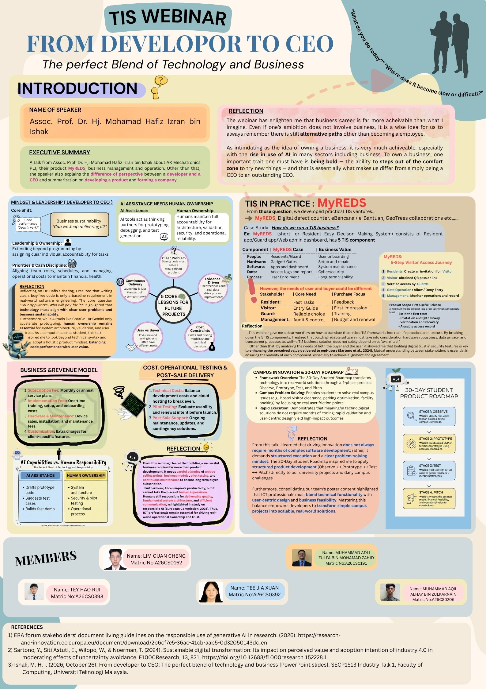

# ⚡ Industry Talk Case Study: From Developer to CEO

  
  
  
  

A comprehensive analysis and e-Portfolio reflection on the industry webinar **"From Developer to CEO: The Perfect Blend of Technology and Business"**, hosted by the Faculty of Computing, Universiti Teknologi Malaysia (UTM).

---

### 📖 Event Overview
- **Event**: Industry Webinar — Technology and Information System (TIS)
- **Topic**: From Developer to CEO: The Perfect Blend of Technology and Business
- **Speaker**: Assoc. Prof. Dr. Hj. Mohamad Hafis Izran bin Ishak (CEO of AR Mechatronics PLT / Associate Professor at UTM)
- **Date & Time**: Monday, 26 October 2026 | 2:00 PM – 4:00 PM
- **Participant**: TEY HAO RUI (Matric No: A26CS0398) | Year 1 Computer Network & Security Student

---

### 🎨 Team Reflection Poster & Evidence
As part of our SECP1513 coursework, our team (Group of 5) collaborated on a reflective poster summarizing key takeaways, business models, user vs. buyer dynamics, and project execution frameworks:

  

 
- 📄 **Poster High-Res File**: [`assets/poster.jpg`](./assets/poster.jpg)
- 📊 **Speaker Presentation Slide**: [`Dr_Hafis_From_Developer_to_CEO_TIS.pdf`](./Dr_Hafis_From_Developer_to_CEO_TIS.pdf)

---

### 💡 Core Takeaways & Business Frameworks

#### 1. Mindset Shift: Developer vs. CEO Responsibilities
| Perspective | Core Question Focus | Primary Focus Areas |
| :--- | :--- | :--- |
| **Developer** | *"Does the system work?"* | Problem analysis, solution architecture, code testing, and bug fixing. |
| **CEO / Founder** | *"Why will customers pay & subscribe?"* | Value proposition, operational sustainability, cash discipline, and revenue models. |

#### 2. Customer Understanding: User vs. Buyer Dynamics
Using the **MyREDS** (Resident Easy Decision System) case study presented by Dr. Hafis:
- **End-Users (Residents/Visitors/Guards)**: Prioritize task speed, intuitive interface, and reliable access control.
- **Buyers (Management/HOA Boards)**: Focus on compliance, auditability, data privacy, and subscription renewals.

#### 3. Revenue Models in Tech Solutions
- **Subscription Services**: Recurring monthly/annual fees.
- **Implementation & Onboarding**: Setup, custom integration, and staff training.
- **Hardware & Maintenance**: Physical gate/device deployment, upkeep, and feature customization.

#### 4. AI Capabilities vs. Human Ownership
- **AI Assistance**: Accelerates prototyping, code generation, error explanation, and test case suggestions.
- **Human Ownership**: Essential for final system architecture, security validation, pilot testing, and post-sale operational reliability.

---

### 💡 Personal Reflection
> *"Writing clean, bug-free code is only a baseline requirement in real-world software engineering—technology must align with user problems and business sustainability."*

As a Year 1 Computer Network & Security student at UTM, this talk reshaped how I view software engineering. Moving forward, I aim to combine technical execution with business awareness—ensuring that network and software solutions I design are not only secure and functional, but also provide clear, scalable value to end-users and organizations.

---

👥 **Team Members (Group Collaboration - Group 5)**:
- TEY HAO RUI (Matric: A26CS0398)
- LIM GUAN CHENG (Matric: A26CS0162)
- TEE JIA XUAN (Matric: A26CS0392)
- MUHAMMAD ADLI ZULFA BIN MOHAMAD ZAHID (Matric: A26CS0191)
- MUHAMMAD AQIL ALHAY BIN ZULKARNAIN (Matric: A26CS0206)
